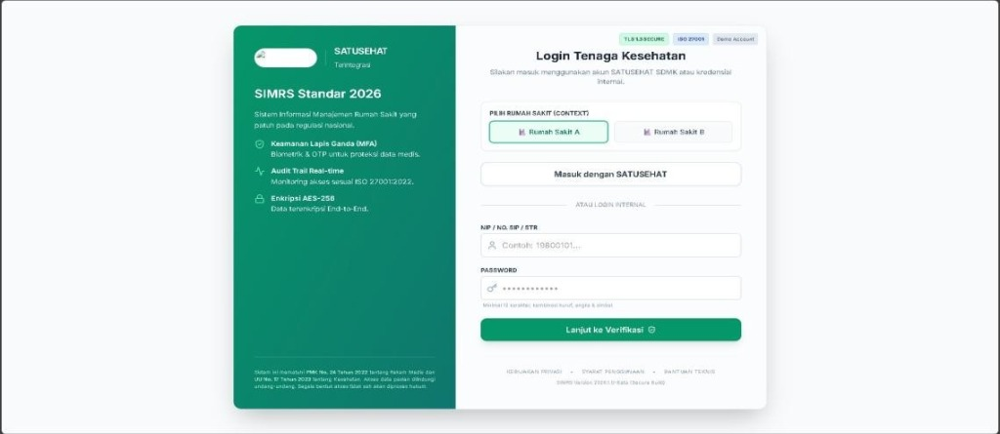
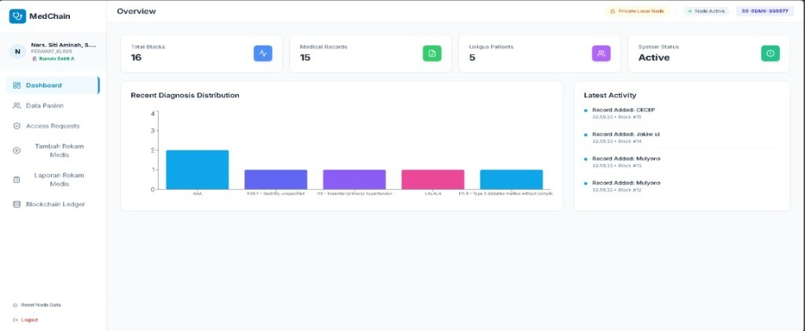
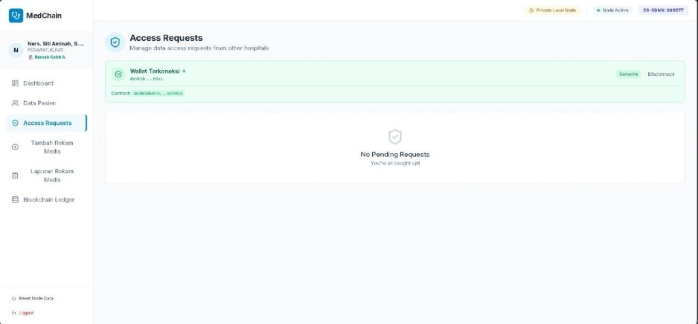
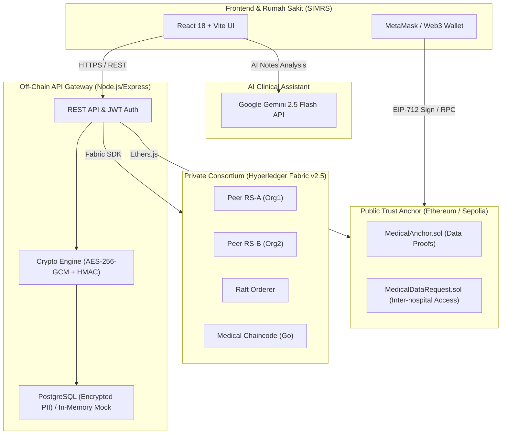

# 🏥 MedChain: National Health Record Ledger

[](https://soliditylang.org/)
[](https://www.hyperledger.org/use/fabric)
[](https://nodejs.org/)
[](https://react.dev/)
[](https://vitejs.dev/)
[](#-keamanan--audit-summary)
[](LICENSE)

> **Platform Rekam Medis Nasional Berbasis Hybrid Blockchain** yang menghubungkan jaringan rumah sakit secara aman, terdesentralisasi, dan patuh regulasi (*PMK No. 24 Tahun 2022, UU No. 17 Tahun 2023 tentang Kesehatan, dan UU No. 27 Tahun 2022 tentang Pelindungan Data Pribadi*).

---

## 📸 Antarmuka Pengguna (Preview)

| 1. Login Tenaga Kesehatan (SATUSEHAT) | 2. Dashboard Ringkasan & Diagnosa |
| :---: | :---: |
|  |  |

| 3. Permintaan Akses Antar Rumah Sakit (Web3 / Ganache) |
| :---: |
|  |

---

## 🏛️ Arsitektur Sistem (Hybrid Blockchain)

MedChain menggabungkan privasi data medis dengan integritas buku besar terdesentralisasi:



### 1. Off-Chain Layer (API Gateway & Storage)
* **Penyimpanan PII Terenkripsi:** Menyimpan data demografis pasien menggunakan enkripsi **AES-256-GCM** dengan salt dan authentication tag untuk integritas data.
* **Pseudonimisasi NIK:** NIK (Nomor Induk Kependudukan) diubah menjadi **PatientUID** menggunakan algoritma **HMAC-SHA256** ber-entropi tinggi agar tidak mengekspos identitas asli ke jaringan blockchain.
* **Dual-Mode Engine:** Berjalan secara otomatis dengan **In-Memory Store** (jika PostgreSQL lokal tidak terpasang) atau **PostgreSQL** penuh.

### 2. Private Consortium Layer (Hyperledger Fabric v2.5)
* Smart contract (Chaincode Go) deterministik untuk mencatat metadata rekam medis, izin akses antar rumah sakit, dan audit log pemindahan data.
* Hak penghapusan rekam medis (*Right to Erasure*) melalui mekanisme *soft delete* yang tetap mempertahankan jejak audit forensik.

### 3. Public Trust Anchor Layer (Ethereum Solidity)
* **MedicalAnchor.sol:** Menyimpan cryptographic hash (SHA-256) bukti transaksi rekam medis dari Hyperledger Fabric ke jaringan publik (Sepolia/Ganache) sebagai *Trust Anchor* yang anti-manipulasi.
* **MedicalDataRequest.sol:** Protokol permintaan data antar rumah sakit dengan rate-limiting per jam dan masa berlaku otomatis 24 jam.

---

## ⚡ Fitur Utama

- [x] **1-Click All-in-One Launcher:** Menjalankan seluruh ekosistem (Backend + Frontend + Browser) otomatis dalam satu klik.
- [x] **Zero-Setup Mock Mode:** Dapat langsung diuji tanpa perlu menginstall Docker atau Hyperledger Fabric secara lokal.
- [x] **Integrasi SATUSEHAT & SIMRS:** Desain antarmuka login tenaga medis sesuai standar SIMRS 2026.
- [x] **Analisis Rekam Medis Berbasis AI:** Integrasi dengan Google Gemini AI untuk analisis catatan gejala klinis dan rekomendasi diagnosa.
- [x] **Audit Trail Forensik:** Pencatatan setiap aksi view, request, dan grant secara real-time.
- [x] **Keamanan Berlapis:** Telah diaudit terhadap kerentanan non-determinisme, backdoor bypass, SQL injection, dan kebocoran kredensial.

---

## 🚀 Panduan Memulai Cepat (Quick Start)

### Prasyarat
* [Node.js](https://nodejs.org/) (versi 18 atau lebih baru)
* npm (terpasang bersama Node.js)

### Cara Menjalankan (1-Click)

1. **Jalankan Launcher:**
   * **Opsi A (File Explorer):** Cukup **double-click** file `start.bat`.
   * **Opsi B (Terminal / PowerShell):**
     ```powershell
     .\start.bat
     ```
     *atau*
     ```powershell
     npm start
     ```

2. **Layanan yang Berjalan Otomatis:**
   * 🖥️ **Frontend Web Dashboard:** [http://localhost:3000](http://localhost:3000)
   * ⚙️ **Backend API Gateway:** [http://localhost:4000](http://localhost:4000)
   * 🩺 **API Health Check:** [http://localhost:4000/api/fabric/health](http://localhost:4000/api/fabric/health)

3. **Menghentikan Layanan:**
   Tekan tombol `Q` pada jendela konsol launcher untuk mematikan seluruh proses secara bersih.

---

## 📂 Struktur Repositori

```text
Medchain/
├── start.bat                     # 🚀 1-Click All-in-One Launcher (Windows Batch)
├── start.ps1                     # 🚀 All-in-One Launcher (PowerShell)
├── package.json                  # Root npm script runner
├── .gitignore                    # Proteksi secrets (.env, artifacts, certs)
├── docs/                         # Dokumentasi & aset gambar
│   └── images/                   # Screenshot antarmuka aplikasi
├── legacy_prototype/             # Frontend React 18 + TypeScript + Vite
│   ├── contracts/                # Smart contract client (MedChain.sol)
│   ├── services/                 # Layanan integrasi API, MetaMask, & Gemini AI
│   ├── components/               # Komponen UI dashboard, form rekam medis
│   └── vite.config.ts            # Konfigurasi bundler Vite (Port 3000)
├── national-health-record-ledger/
│   ├── docker/                   # Docker Compose untuk Postgres, Ganache, & Fabric
│   ├── off-chain/
│   │   └── api-gateway/          # Backend Node.js / Express REST API
│   │       ├── src/controllers/  # Hospital, Record, & Access Controllers
│   │       ├── src/middleware/   # JWT Authentication & Authorization
│   │       ├── src/services/     # Database (PostgreSQL + In-Memory Fallback)
│   │       └── src/utils/        # Kriptografi AES-256-GCM & HMAC
│   └── on-chain/
│       ├── ethereum/             # Smart Contracts Solidity (Hardhat)
│       │   └── contracts/        # MedicalAnchor.sol & MedicalDataRequest.sol
│       └── hyperledger/          # Smart Contracts Hyperledger Fabric (Go)
│           └── chaincode/        # main.go (Deterministik & Access Controlled)
└── postman_collection.json       # Koleksi endpoint Postman untuk pengujian API
```

---

## 🛡️ Keamanan & Audit Summary

Repository ini telah melalui proses audit menyeluruh dan perbaikan kerentanan:
1. **Pencegahan Non-Determinism:** Chaincode Fabric menggunakan timestamp transaksional `ctx.GetStub().GetTxTimestamp()` untuk menjamin konsensus antar peer.
2. **Kriptografi Standar Medis:** Menggunakan AES-256-GCM (AEAD) dengan otentikasi tag 16-byte untuk menjamin integritas data terenkripsi.
3. **Proteksi Injeksi SQL:** Seluruh query update dinamis diamankan menggunakan *strict column whitelisting*.
4. **Pemberantasan Backdoor:** Menghapus dev token bypass tidak aman pada middleware otentikasi.
5. **Sanitasi Kredensial:** Seluruh private key pengujian dan RPC token telah dibersihkan dari git tracking.

---

## 📄 Lisensi

Proyek ini dirilis di bawah lisensi [MIT](LICENSE).
Dikembangkan untuk mendukung standardisasi sistem informasi kesehatan digital nasional.
